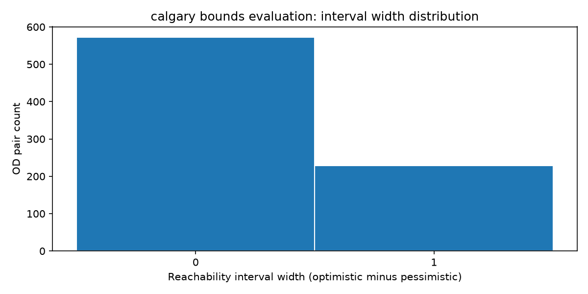

# Corrected accessibility routing results

Post-result repair round 2026-10-01. Previous routing results and H1/H2/H3 support claims are withdrawn. Results below are generated from the retained public feed snapshots.
Hardware/platform record: Darwin 27.0.0 (arm64).

Preregistration SHA-256 (phase 2 prefix): `b9b793b753bffcf761232632f85a910ee2af444a8db6018aaf9ffc1dc262bde2`.

| Feed | Mean width | Nominal 95% crossed interval | n | Optimistic | Pessimistic | Schedule-only |
|------|-----------:|:----------------------------|--:|-----------:|------------:|--------------:|
| ttc | 0.00000 | [0.00000, 0.00000] | 800 | 50 | 50 | 330 |
| calgary | 0.28500 | [0.19500, 0.40000] | 800 | 228 | 0 | 228 |
| edmonton | 0.13625 | [0.08375, 0.20000] | 800 | 190 | 81 | 190 |

Intervals use 1,000 seeded crossed origin/destination bootstrap replicates, resampling origins within resolved accessibility strata. They are nominal intervals, not certified coverage. [Post-result uncertainty amendment](docs/amendments/AMENDMENT_2026-10-01_05_uncertainty.md); [Owen](https://arxiv.org/abs/0712.1111).

## ttc

Service date: 2026-10-07. Unknown stops / trips: 0 / 0. Retained optimistic / pessimistic / schedule-only trips: 7465 / 7465 / 40437.

Source: [ttc feed](https://ckan0.cf.opendata.inter.prod-toronto.ca/dataset/b811ead4-6eaf-4adb-8408-d389fb5a069c/resource/c920e221-7a1c-488b-8c5b-6d8cd4e85eaf/download/completegtfs.zip). Licence record: [data licences](DATA_LICENSES.md). Snapshot SHA-256: `5e0191d59cb991b6c88ba9c1a5f2ca93a5a064a4d258dbc7ba93801d15f3dfca`.

### Verification ranking

Ranking not run (not_primary_feed).

| Field | Best-case reduction | Accessible outcome width | Inaccessible outcome width | Affected pairs |
|-------|--------------------:|-------------------------:|---------------------------:|---------------:|
| Ranking not run | n/a | n/a | n/a | n/a |

Candidates total 0; evaluated 0; skipped 0; positive targets 0; ranking runtime 0.000 s.
Publisher acknowledgement: Contains information licensed under the Open Government Licence – Toronto.

Validator status: completed; notice categories 14; error categories 1.

## calgary

Service date: 2026-09-30. Unknown stops / trips: 6220 / 62862. Retained optimistic / pessimistic / schedule-only trips: 7926 / 0 / 7926.

Source: [calgary feed](https://data.calgary.ca/download/npk7-z3bj/application/zip). Licence record: [data licences](DATA_LICENSES.md). Snapshot SHA-256: `5fd8928daec49cd85f8026a4186a8b8652d5cb8b2365b3750328360dcddd62c7`.

### Verification ranking

Exact single-field counterfactual recomputation on a time-selected subset of unknown fields, using the sampled OD pairs. Ranking is only among evaluated fields; skipped impact is unknown. Both outcomes share the same walking graph. Best-case reduction is the larger outcome reduction, not expected value. Budgets are soft candidate-start budgets: a running candidate can exceed them.

| Field | Best-case reduction | Accessible outcome width | Inaccessible outcome width | Affected pairs |
|-------|--------------------:|-------------------------:|---------------------------:|---------------:|
| stop 4585 | 0.04250 | 0.28500 | 0.24250 | 34 |
| stop 4801 | 0.02750 | 0.28500 | 0.25750 | 22 |
| stop 4537 | 0.02250 | 0.28500 | 0.26250 | 18 |
| stop 5133 | 0.02250 | 0.28500 | 0.26250 | 18 |
| stop 3406 | 0.01750 | 0.28500 | 0.26750 | 14 |
| stop 3014 | 0.01625 | 0.28500 | 0.26875 | 13 |
| stop 3368 | 0.01625 | 0.28500 | 0.26875 | 13 |
| stop 2194 | 0.01375 | 0.28500 | 0.27125 | 11 |
| stop 3765 | 0.01375 | 0.28500 | 0.27125 | 11 |
| stop 5253 | 0.01375 | 0.28500 | 0.27125 | 11 |
| stop 6121 | 0.01375 | 0.28500 | 0.27125 | 11 |
| stop 6603 | 0.01375 | 0.28500 | 0.27125 | 11 |
| stop 7294 | 0.01250 | 0.28500 | 0.27250 | 10 |
| stop 2063 | 0.01125 | 0.28500 | 0.27375 | 9 |
| stop 2486 | 0.01125 | 0.28500 | 0.27375 | 9 |

Candidates total 69082; evaluated 38; skipped 69044; positive targets 38; ranking runtime 600.493 s. Soft candidate-start budget 600 s.
Publisher acknowledgement: Contains information licensed under the Open Government Licence – City of Calgary.

Validator status: completed; notice categories 13; error categories 2.

### Transfer Sensitivity

| Settings | Mean width | Optimistic | Schedule-only |
|----------|-----------:|-----------:|--------------:|
| {'min_transfer_minutes': 3, 'max_travel_minutes': 45} | 0.14625 | 117 | 117 |
| {'min_transfer_minutes': 3, 'max_travel_minutes': 60} | 0.33000 | 264 | 264 |
| {'min_transfer_minutes': 3, 'max_travel_minutes': 90} | 0.65500 | 524 | 524 |
| {'min_transfer_minutes': 5, 'max_travel_minutes': 45} | 0.13750 | 110 | 110 |
| {'min_transfer_minutes': 5, 'max_travel_minutes': 60} | 0.28500 | 228 | 228 |
| {'min_transfer_minutes': 5, 'max_travel_minutes': 90} | 0.62750 | 502 | 502 |
| {'min_transfer_minutes': 10, 'max_travel_minutes': 45} | 0.10750 | 86 | 86 |
| {'min_transfer_minutes': 10, 'max_travel_minutes': 60} | 0.21875 | 175 | 175 |
| {'min_transfer_minutes': 10, 'max_travel_minutes': 90} | 0.52125 | 417 | 417 |

### Walk Sensitivity

| Settings | Mean width | Optimistic | Schedule-only |
|----------|-----------:|-----------:|--------------:|
| {'walk_speed_mps': 1.0, 'walk_radius_m': 200.0} | 0.19750 | 158 | 158 |
| {'walk_speed_mps': 1.0, 'walk_radius_m': 300.0} | 0.24500 | 196 | 196 |
| {'walk_speed_mps': 1.0, 'walk_radius_m': 500.0} | 0.29250 | 234 | 234 |
| {'walk_speed_mps': 1.4, 'walk_radius_m': 200.0} | 0.21375 | 171 | 171 |
| {'walk_speed_mps': 1.4, 'walk_radius_m': 300.0} | 0.28500 | 228 | 228 |
| {'walk_speed_mps': 1.4, 'walk_radius_m': 500.0} | 0.32000 | 256 | 256 |
| {'walk_speed_mps': 1.8, 'walk_radius_m': 200.0} | 0.21875 | 175 | 175 |
| {'walk_speed_mps': 1.8, 'walk_radius_m': 300.0} | 0.30000 | 240 | 240 |
| {'walk_speed_mps': 1.8, 'walk_radius_m': 500.0} | 0.35500 | 284 | 284 |

## edmonton

Service date: 2026-09-30. Unknown stops / trips: 416 / 0. Retained optimistic / pessimistic / schedule-only trips: 12227 / 7858 / 12227.

Source: [edmonton feed](https://gtfs.edmonton.ca/TMGTFSRealTimeWebService/GTFS/gtfs.zip). Licence record: [data licences](DATA_LICENSES.md). Snapshot SHA-256: `553a9557294910b91c09f10c77cbde47129e9c9e8ddc8671b34b1d242e3561fb`.

### Verification ranking

Exact single-field counterfactual recomputation on a time-selected subset of unknown fields, using the sampled OD pairs. Ranking is only among evaluated fields; skipped impact is unknown. Both outcomes share the same walking graph. Best-case reduction is the larger outcome reduction, not expected value. Budgets are soft candidate-start budgets: a running candidate can exceed them.

| Field | Best-case reduction | Accessible outcome width | Inaccessible outcome width | Affected pairs |
|-------|--------------------:|-------------------------:|---------------------------:|---------------:|
| stop 4790 | 0.02125 | 0.12125 | 0.11500 | 17 |
| stop 2901 | 0.01625 | 0.13125 | 0.12000 | 13 |
| stop 2536 | 0.01500 | 0.12875 | 0.12125 | 12 |
| stop 2673 | 0.01250 | 0.13625 | 0.12375 | 10 |
| stop 3863 | 0.01250 | 0.13125 | 0.12375 | 10 |
| stop 22994 | 0.00875 | 0.13000 | 0.12750 | 9 |
| stop 2078 | 0.00875 | 0.13625 | 0.12750 | 7 |
| stop 8771 | 0.00875 | 0.13250 | 0.12750 | 7 |
| stop 2057 | 0.00875 | 0.13625 | 0.12750 | 7 |
| stop 2374 | 0.00875 | 0.13625 | 0.12750 | 7 |
| stop 2693 | 0.00875 | 0.13625 | 0.12750 | 7 |
| stop 2694 | 0.00875 | 0.13625 | 0.12750 | 7 |
| stop 3442 | 0.00625 | 0.13625 | 0.13000 | 5 |
| stop 4222 | 0.00500 | 0.13375 | 0.13125 | 4 |
| stop 6718 | 0.00500 | 0.13625 | 0.13125 | 4 |

Candidates total 416; evaluated 58; skipped 358; positive targets 45; ranking runtime 1812.588 s. Soft candidate-start budget 1800 s.
Publisher acknowledgement: Contains information licensed under the Open Government Licence – City of Edmonton.

Validator status: completed; notice categories 6; error categories 0.

## Synthetic regression fixture

The fixture is for correctness tests only, not real-data evidence. Source: [fixture builder](scripts/build_fixtures.py); licence: [Apache-2.0](LICENSE).

| Entity | Width reduction | Affected pairs |
|--------|----------------:|---------------:|
| stop S1 | 0.40000 | 8 |

## Interpretation and limitations

Positive width measures sensitivity to missing metadata under the declared routing policy. It does not establish on-street accessibility or practical benefit from field verification. Zero width is a null policy-difference result, not universal accessibility.

All stops on retained trips must pass the policy, including pass-through stops. Walking-only journeys require permitted endpoints and intermediate stops. Walks consume no boarding rounds; transfer slack is charged once before later boardings plus walking time. Geodesic walking omits street barriers. Frequency, pathway, transfer-rule and pickup/drop-off modelling remain outside this evaluation. [GTFS field semantics](https://gtfs.org/documentation/schedule/reference/).

## Reproduce

```bash
python scripts/regenerate_publication.py
```

Numerical evaluation wall time including reading, ranking, sensitivities, validators and plotting: 2798.921 s.

Largest observed complete-tree sample: unavailable (unavailable). Stop enforcement: could_not_be_enforced. This is not a certified process-tree peak or hard memory cap. Samples are non-atomic; transient peaks can be missed. RSS excludes compressed/swapped memory. An unavailable sample means the stop could not be enforced for that interval. [Memory/resource correction](docs/amendments/AMENDMENT_2026-10-01_06_publication.md); [Python subprocess semantics](https://docs.python.org/3/library/subprocess.html).



[Machine-readable output, sampled keys and per-pair results](docs/bounds_eval/evaluation.json).
